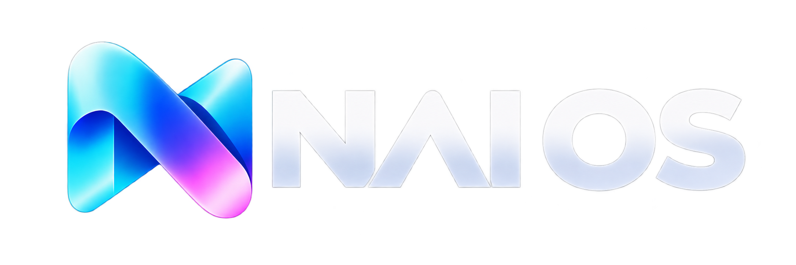

<div align="center">


# NAI-Lattice

**A local-first, enterprise-grade, event-sourcing + CQRS multi-dimensional datalake.**

_The Ambient Fabric's observability plane — an event store that runs like a real
backend you own, not a cloud you rent._

[Source](https://github.com/cyberluke/NAI-Lattice) · [NAI OS](https://github.com/cyberluke/NAI-OS) · [Architecture](docs/ARCHITECTURE.md) · [Donate](https://revolut.me/lukalita) · [License](LICENSE)

</div>

---

## Why this exists

Every serious agentic system eventually needs to **answer questions about its
own history**: "what did this trace do", "show me all events for this entity
over the last hour", "which producer emitted that error", "replay me the exact
delta since cursor X". Do that naively and you scan the whole event store per
query — that does not scale past a weekend of telemetry.

NAI-Lattice stores events the way a serious log/audit backend should — with a
canonical write path, hash-chained segments, crash-consistent replay — and then
lays **materialized, time-ordered, multi-dimensional indexes** (CQRS projections)
over the store so first-class queries are a B-tree key descent, not a scan.

It runs **entirely on your own machine**. No cloud, no data leaves your box, no
vendor locks your logs.

## What you get

- **Event-sourcing ledger** — append-only, immutable, BLAKE3 hash-chained,
  SurrealKV-backed. Nothing is overwritten or deleted.
- **Deterministic write path** — one linearizable append lock; batch
  durable group-commit; crash recovery seals a torn tail and replays forward.
- **Read models you actually trust** — `LedgerReadModel` (live tail/cursor)
  and `MultiDimIndex` (namespace/entity/type/producer/correlation/time-range),
  each with its own lock/bulkhead, each resuming from a **durable cursor**
  (O(restart-delta), never a cold scan).
- **First-class indexed queries** via the `index.query` capability —
  newest-N-per-key from a materialized time-keyed B-tree. On a 1M-event ledger
  a single-producer query is ~**68× faster** than a full linear scan.
- **Windows-first, release-shipped** — builds and ships as a release binary.
- **Observability-first** — a live dashboard + SSE, and the fabric's own
  telemetry writes back into the same ledger it serves.

## First production integration: NAI OS

<p align="center">
  <a href="https://github.com/cyberluke/NAI-OS">
    
  </a>
</p>

**[NAI OS](https://github.com/cyberluke/NAI-OS)** is the first production-ready
integration of NAI Lattice — an AI-native Windows desktop with a dock, launcher,
window manager, widgets, themes, a curated store for AI and agentic apps
(MCP + `SKILL.md`), and N-Pilot, its local agent.

It runs `nai-fabric-host` as the per-user runtime and gives the shell one
durable substrate:

- **N-Pilot** keeps task, thread and relationship state in the canonical ledger
  instead of an app-private database.
- **Observability** is the host's live dashboard and event stream on
  `127.0.0.1:8787`, backed by the same canonical ledger.
- **App assets** can be federated through AAF and CAS instead of duplicated.
- **Host lifecycle** follows the production path: versioned runtime,
  `active.json`, supervised monitor/worker, live release swap and crash recovery.

The host manifest records SHA-256 and the signer identity; releases are signed
with the NAI sovereign chain — see [`SECURITY.md`](SECURITY.md).

Integration notes: [docs/NAI-OS.md](docs/NAI-OS.md).

## Quick start

```bash
cargo build --release -p nai-fabric-host
target/release/nai-fabric-host.exe
# resolves endpoint.json (named pipe), binds control HTTP on 127.0.0.1:8787
```

> **Shipping the host inside a NAI product?** Follow
> [docs/PRODUCT_BUNDLING.md](docs/PRODUCT_BUNDLING.md): bundle the exe +
> manifest, install into the shared `runtime\<version>` root, maintain
> `active.json`, and spawn the host directly. The optional
> `helldesk-release` binary is developer tooling, **not** the product contract;
> products never invoke it or write `releases\current.json`.

Then write an event:

```bash
target/release/nai-lattice-cli event append \
  --namespace observability.log.v1 \
  --event-type log.record \
  --payload '{"level":"info","message":"hello from the ledger"}'
```

And query it through the multi-dim index:

```bash
target/release/nai-lattice-cli index query \
  --dim namespace --value observability.log.v1 --limit 10
```

## Architecture in 60 seconds

```
Writes  →  Ledger (one authoritative append, hash-chained)
              │
              ▼  (background worker, 250ms, idempotent replay)
Reads   →  LedgerReadModel (hot-queue tail)  +  MultiDimIndex (b-tree dims)
              │
              ▼
         event.read_range | index.query | dashboard/SSE
```

Every read model owns its own lock and its own durable cursor. The write path
never serves reads; a slow reader can never slow a writer. Full detail in
[`docs/ARCHITECTURE.md`](docs/ARCHITECTURE.md).

## Status

Active, production hardware in daily use for the NAI Ambient Fabric observability
plane. Exploratory but honest: the index ships only because its benchmark beats
a full scan on the query it exists to serve. We measure before we project.

## ❤️ Support Independent Development

NAI-Lattice is independently developed and open source.

If you enjoy my projects and would like to support their continued development, voluntary donations are always appreciated.

[☕ Donate via Revolut](https://revolut.me/lukalita)

<a href="https://revolut.me/lukalita">
  
</a>

Scan the QR code or use the link above to make a one-time donation.

Every contribution helps. Thank you for your support! 🧪

## Contributing & license

- [CONTRIBUTING.md](CONTRIBUTING.md) — process, contracts (`LEDGER-*`,
  `CQRS-*`, `NAF-*`), and the "SurrealKV stays authoritative" ground rule.
- [LICENSE](LICENSE) — **Apache-2.0** (patent grant, enterprise-friendly).
