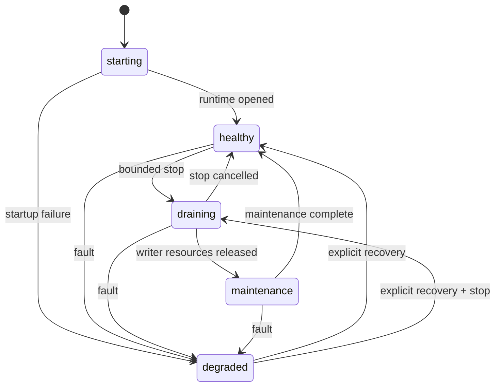

# Runtime lifecycle, maintenance lease and feature discovery

Status: **implemented in `crates/lattice-runtime` for the 0.1.3 M1 batch**
(NAIOS-002 state/lock/events, NAIOS-004 discovery, NAIOS-014 provenance,
NAIOS-017 degraded state). Owner: NAI-Lattice. Contract consumers:
`runtime.health`, `runtime.describe`, `runtime.maintenance.*`, the host's
lifecycle snapshot, and the dashboard/SSE state lane.

Frozen dashboard shape: `docs/DASHBOARD_API.md` §1 (`health`, `version`,
`features`) and §4 (`state` event). This document describes the producer side;
the HTTP/SSE mapping stays owned by `apps/nai-fabric-host`.

## 1. State machine



| State | Meaning |
|---|---|
| `starting` | Controller created; runtime resources may not serve yet. |
| `healthy` | Runtime opened and serving. Set by `LatticeRuntime::open`. |
| `draining` | Reported bounded stop. **Admission enforcement is host-owned** (see §8). |
| `maintenance` | A maintenance actor owns (or is about to own) the writer resources. |
| `degraded` | A fault is active. Wins over `maintenance` and every other state. |

`LifecycleController` starts in `starting`. `LatticeRuntime::open` moves it to
`healthy` once the ledger/hot store/CAS/search stack is open. The host may then
set `draining` / `maintenance` / `degraded` explicitly.

### Effective state resolution (`runtime.health.state`)

The controller state and the lease are both inputs:

1. If the controller is `degraded`, **`degraded` wins** (a live lease does not
   hide an active fault).
2. Else if a **live** maintenance lease exists, `maintenance` is reported even
   when the controller still says `healthy`.
3. Else if the lock file exists but is **unreadable** (empty, partial, bad
   schema, I/O error), `maintenance` is reported conservatively — a torn write
   must never open a takeover window.
4. Else the controller state is reported.

`since_unix_ms` is the controller's state start, except when a live lease forces
`maintenance` from a non-maintenance controller state: then it is the lease's
`acquired_at_unix_ms`. `age_ms` (host snapshot only) follows the same rule.
`detail` explains the forcing lease when the controller has no matching detail.
`last_error` is sticky until overwritten by `record_error` or cleared with
`clear_error`; state transitions do not erase it.

## 2. `runtime.health` (extended, additive)

All previous fields are preserved. New fields are additive; no key changed
shape.

```json
{
  "state": "maintenance",
  "detail": "maintenance lock held by nai-os (prune)",
  "last_error": null,
  "since_unix_ms": 1764000000000,
  "uptime_ms": 183204,
  "maintenance_lock": {
    "owner": "nai-os",
    "reason": "prune",
    "pid": 1234,
    "acquired_at_unix_ms": 1764000000000,
    "expires_at_unix_ms": 1764000900000
  },
  "runtime_instance_id": "nai-lattice-0192f...",
  "ledger_high_water_mark": 4851,
  "provider_health": [],
  "hot_store": "surreal"
}
```

- `maintenance_lock` is `null` when no live lease exists. The holder's fencing
  token is **never** included.
- `uptime_ms` is monotonic (`Instant`), not wall-clock arithmetic.
- `ledger_high_water_mark` is the ledger's allocated sequence high-water, as
  before. It may include not-yet-flushed batched frames; it is a cursor, not a
  durability claim.

`LatticeRuntime::lifecycle_json()` returns the same ledger-independent subset
(`state`, `detail`, `last_error`, `since_unix_ms`, `age_ms`, `uptime_ms`,
`maintenance_lock`) for the host's `/lattice/api/summary` mapping without an
async ledger read.

## 3. `runtime.describe` (provenance + feature discovery)

```json
{
  "name": "NAI Ambient Fabric",
  "naf_version": 1,
  "storage_schema_version": 1,
  "runtime_instance_id": "nai-lattice-0192f...",
  "root": "C:\\Users\\me\\AppData\\Local\\NAI\\Lattice\\v1",
  "host_version": "0.1.3",
  "dashboard_version": "0.1.0",
  "protocol_min": 1,
  "protocol_max": 1,
  "features": [
    "lifecycle_api",
    "maintenance_api",
    "search_api",
    "shutdown_if_idle",
    "sse_resume",
    "storage_api",
    "host_metrics",
    "gpu_metrics",
    "topology_api",
    "execution_chain_api"
  ]
}
```

- `host_version` is `env!("CARGO_PKG_VERSION")` of the built runtime crate.
- `dashboard_version` is `null` until the host calls
  `LatticeRuntime::set_dashboard_version("x.y.z")`. The first non-empty value
  wins; a later different value is ignored and logged, so provenance cannot
  drift mid-run.
- `protocol_min` / `protocol_max` are the NAF range this build speaks (`1`/`1`).
- `features` is the **sorted union** of runtime-owned features and
  host-registered names (`register_host_features`). Duplicates and blanks are
  ignored. Discovery advertises only implemented capabilities; use feature
  names, not version-string comparisons.

## 4. Maintenance lease

Path: `<runtime root>/maintenance.lock.json`. For the default runtime,
`<runtime root>` is `%LOCALAPPDATA%\NAI\Lattice\v1`, i.e. the same root as the
ledger. The runtime exposes the lease through `LatticeRuntime::maintenance()`.

### 4.1 Record

```json
{
  "schema": 1,
  "owner": "nai-os",
  "reason": "prune",
  "token": "<64 hex chars>",
  "pid": 1234,
  "acquired_at_unix_ms": 1764000000000,
  "expires_at_unix_ms": 1764000900000
}
```

- `owner` is an identity label, not an authenticator. The **token** is the
  fencing credential: 148 random bits, returned exactly once by `acquire`.
- The token is never written to health, status or refusal payloads. Treat a
  leaked token as a leaked lease credential.
- `schema` must be `1`; any other schema is `lock_unreadable` and is never
  reclaimed automatically.
- Times are wall-clock milliseconds. All actors are on one machine sharing one
  clock; cross-machine locking is out of scope.

### 4.2 Acquire / renew / release rules

| Operation | Rule |
|---|---|
| Acquire | `OpenOptions::create_new` — atomic on a local filesystem; one winner. A live record refuses with `{ok:false,"reason":"locked","holder":{...}}`. `ttl_ms` must be > 0. |
| Reclaim | Only an expired record is reclaimable. The observed file is atomically renamed aside, re-read, and deleted only if it is still the same token and still expired. `reclaimed:true` reports this. |
| Release | Requires the exact token. The file is renamed aside and re-read before deletion, so a stale read cannot delete a lock that was replaced meanwhile. A foreign token is refused `not_owner`; the file is left untouched. |
| Extend | Requires the exact token and a live record. The expiry is recomputed from `now` (`now + ttl_ms`). An expired record refuses `expired` even with the right token: re-acquire instead. |
| Unreadable | Never stolen, never released, never re-written by an actor that did not create it. Refused `lock_unreadable`. |

### 4.3 TTL guidance and limits

- There is **no default and no cap** on `ttl_ms`; callers own the policy. Use
  the shortest window that covers the operation plus a comfortable margin.
- Renew at or before 50% of the TTL. A lease that expires while its holder is
  descheduled can be legitimately reclaimed by another actor.
- Expiry is checked against wall clock on every read. No heartbeat is implicit:
  if you do not call `extend`, the lease expires.
- The lease coordinates **access**, it does not fence **writes**. Before a
  maintenance actor mutates the store it must still stop the serving worker and
  release its writer resources (OS file handles / single-writer guarantee). The
  token makes a stale holder fail loudly; it cannot make two writers safe.

### 4.4 Exact reclaim race window (honest disclosure)

The file is re-read after every rename, so the common two-reclaimer interleaving
never yields two simultaneous holders: the loser discovers the winner's live
token and restores the file it moved. Residual windows, in full:

1. **Third actor in the restore gap.** If a third process creates a new lease
   between a reclaimer's rename and its restore, the restore destination is
   occupied. The reclaimer refuses and leaves the moved record at
   `maintenance.lock.json.stale.<token>` for manual inspection. It is never
   deleted (ownership unknown). The original holder's next `release` fails with
   `not_owner` against the third lease, so it learns it lost. Requires three
   concurrent maintenance actors within microseconds.
2. **Expiry vs. a still-alive holder.** TTL expiry is not proof that the old
   holder stopped writing. An actor descheduled past its TTL can still believe
   it holds the lease. Token checks make its renew/release fail, but only
   stopping its writer resources makes takeover safe (§4.3).
3. **Extend is in-place.** Extend truncate-writes the new record so the path
   never disappears. If the record expires in the microseconds between token
   verification and the write and another actor reclaimed it, the write could
   overwrite the newcomer's record. Renewing early makes this unobservable; no
   new dependency was added for an atomic replace.
4. **Torn write.** A crash during extend can leave an empty/partial file. It is
   reported as unreadable and blocks takeover until an operator removes it.
   Safety is preserved; liveness is not.

The full module documentation is in `crates/lattice-runtime/src/lifecycle.rs`
("Exact reclaim race window").

## 5. NAF methods

All four are in `RUNTIME_SERVED_CAPABILITIES` and dispatched by
`LatticeRuntime::dispatch`. Lock refusals are **HTTP-success NAF responses**
carrying `{ok:false, reason, holder}` — they are not protocol errors. Malformed
arguments (missing owner/token/ttl, zero TTL) are `BadArgs` errors.

### 5.1 `runtime.maintenance.status`

Request: `{}` (no arguments).

```json
{"ok":true,"locked":true,"expired":false,
 "holder":{"owner":"nai-os","reason":"prune","pid":1234,
           "acquired_at_unix_ms":1764000000000,
           "expires_at_unix_ms":1764000900000},
 "expires_in_ms":841000}
```

- `locked:false` + `holder:null` when absent.
- An expired file returns `locked:false`, `expired:true`, `holder:{...}`,
  `expires_in_ms:0` (it is reclaimable, not held).
- Unreadable: `locked:null`, `expired:null`, `holder:null`, `unreadable:true`,
  `detail:"..."`.

### 5.2 `runtime.maintenance.acquire`

Request: `{"owner":"nai-os","reason":"prune","ttl_ms":900000}`

```json
{"ok":true,"token":"<64 hex>","reclaimed":false,
 "lock":{"owner":"nai-os","reason":"prune","pid":1234,
          "acquired_at_unix_ms":1764000000000,
          "expires_at_unix_ms":1764000900000}}
```

Refusal: `{"ok":false,"reason":"locked","holder":{...}}` or
`{"ok":false,"reason":"lock_unreadable","holder":null,"detail":"..."}`.
`reclaimed:true` means an expired lease was replaced.

### 5.3 `runtime.maintenance.release`

Request: `{"token":"<token from acquire>"}`

```json
{"ok":true,"released":true,"lock":{...prior holder...}}
```

Refusals: `not_locked`, `not_owner` (with the current holder), `lock_unreadable`.
A wrong token never deletes the file.

### 5.4 `runtime.maintenance.extend`

Request: `{"token":"<token from acquire>","ttl_ms":900000}`

```json
{"ok":true,"lock":{...renewed holder...}}
```

Refusals: `not_locked`, `not_owner`, `expired`, `lock_unreadable`. The response
never echoes the token; the caller already has it.

### 5.5 `runtime.storage.status`

Request: `{}`

Returns the `docs/DASHBOARD_API.md` §1 `storage` payload: class sizes, budget,
free/reserve bytes, pressure, retention and `lastPrune`, computed by the shared
`nai-lattice-storage` policy crate (the same crate the CLI and
`/lattice/api/summary` use). Read-only. If the volume cannot be queried,
`freeBytes`/`budgetBytes`/`reserveBytes` are `null` and `pressure` is `"unknown"`.

### 5.6 `runtime.maintenance.prune_safe`

Request: `{"apply":true}`

Safe, bounded housekeeping while the host keeps running: stale rotated logs/tmp,
expired backups and audit rotation only. It never touches `ledger`, `cas`, `hot`,
`search`, `vector`, read-model files, `active.json`, `runtime/` or
`maintenance.lock.json`; the currently written log/audit file is skipped.

```json
{"schema":1,"dry_run":false,"items":3,"bytesFreed":1048576,
 "auditAppended":true,"plan":[{"path":"...","bytes":1048576,
 "reason":"stale-log","class":"logs"}]}
```

`apply` must be exactly `true`; anything else is a dry run. The call is refused
while another live maintenance lease is held. The write appends the same
`maintenance.audit.jsonl` record the CLI writes.

## 6. Lifecycle events

Every controller transition (`set_lifecycle_state`) and every successful lock
acquire/release appends one record through the runtime's canonical ledger path:

- namespace: `observability.log.v1`
- event type: `runtime.state`
- durability: `Durability::Durable`
- producer: `nai.lattice.runtime`

> **Deviation from the brief (durability class).** The brief asked for a
> durable-batched record. `lattice-ledger`'s `BatchedDurable` advances the
> logical tail hash on enqueue but defers the physical write; any later
> `Durable`/`ProjectionOnly` append from another producer is written first, so
> the deferred frame lands out of physical order and `segment::recover` stops at
> the broken hash chain. That hides the lifecycle record **and** subsequent
> events from readers until segment rotation. Transitions are rare, so a durable
> append (one fsync per transition) is proportional and preserves the chain.
> Fixing `BatchedDurable` is a ledger-layer change outside this lane.

Payload:

```json
{
  "level": "info",
  "component": "lattice.runtime",
  "message": "runtime.state healthy -> maintenance",
  "extras": {
    "event_type": "runtime.state",
    "from": "healthy",
    "to": "maintenance",
    "detail": "maintenance lock acquired by nai-os (prune)",
    "eta_ms": 5000
  }
}
```

- `detail` is `null` when unknown.
- `eta_ms` is present only when a caller supplied a real estimate
  (`set_lifecycle_state_with_eta`); it is never invented.
- Lock events use effective states, so acquire reports
  `healthy -> maintenance` and release reports `maintenance -> healthy`.
- Best-effort: a failed append or flush is recorded as `last_error` and never
  fails the transition. `set_lifecycle_state` updates the controller
  synchronously and appends asynchronously on the runtime executor (cheap and
  safe from a shutdown path); maintenance dispatch paths await the append.

SSE `state` events and reconnect replay are host-side concerns
(`docs/DASHBOARD_API.md` §4); this batch produces the durable audit record that
the host can map.

## 7. Feature matrix

Source-required names from NAIOS-004. The runtime advertises only what this
crate implements and enables; the host may register additional host-owned names
via `register_host_features`.

| Feature | Advertised by runtime | Owner / status |
|---|---|---|
| `lifecycle_api` | yes (runtime-owned) | this batch: `runtime.health` lifecycle fields, `set_lifecycle_state`, `lifecycle_json` |
| `maintenance_api` | yes (runtime-owned) | this batch: `runtime.maintenance.status/acquire/release/extend` + `prune_safe` |
| `storage_api` | yes (runtime-owned) | `runtime.storage.status`; same payload as `/lattice/api/summary.storage`; runtime pins included |
| `host_metrics` | yes (host-registered) | `/lattice/api/host-metrics`: CPU, memory, every real adapter and the NPU inventory |
| `gpu_metrics` | conditional (host) | registered only when `nvidia-smi` returns a real GPU |
| `topology_api` | yes (host-registered) | `/lattice/api/topology`: component graph from real trace spans |
| `execution_chain_api` | yes (host-registered) | `/lattice/api/v2/traces/{id}/graph`: explicit spans/calls only |
| `shutdown_if_idle` | no (host-registered) | served by the host control path; registered by the host when enabled |
| `search_api` | yes (host-registered) | host registers it; `/lattice/api/query` cursor paging + exact filters |
| `sse_resume` | yes (host-registered) | host registers it; broker-backed resume (`Last-Event-ID` / `?after=`) |
| `embed` | no | preview shell supports `?embed=1`, but the capability is not advertised until the WebView2 gate passes |
| `compression` | no | not implemented; blocked on a rollback-compatible format boundary |
| `activation` | yes (host-registered, monitor-owned) | manager handshake v1 (`docs/ACTIVATION.md`): monitor-owned validation/drain/start/verify/commit/rollback; advertised only when the monitor owns the handshake |

The runtime-owned features are exposed as `RUNTIME_OWNED_FEATURES`. Consumers
must treat an absent `features` list (older hosts) as "unknown", not as
"unsupported".

## 8. Not implemented in this batch

### NAIOS-001 — activation without restarting NAI OS

**Implemented as a monitor-owned manager handshake** (`docs/ACTIVATION.md`): the
stable monitor validates the staged dir/version/hash/signature/protocol/storage/
token, drains the worker through `runtime.shutdown_if_idle`, starts the candidate
with the existing supervisor path, verifies the new endpoint + NAF handshake,
commits `active.json` under the manager mutex, and rolls back verbatim on any
error. A crash journal is resolved on monitor start. `activation` is advertised
only when the monitor owns the handshake.

**Not done here:** the one authorized production activation (needs V02 signing and
owner authorization). Activation accepts both the canonical Authenticode
`"Valid"` and the legacy `"Signed"` label. No state is faked; an isolated E2E
recorded a real commit and a real rollback.

### Other explicitly out of scope

- **Draining admission control.** Implemented by the **host**: after the shutdown
  latch, non-health dispatches get `503 draining`, in-flight work drains (5 s cap),
  then the flush and exit run. The runtime crate itself does not gate dispatch.
- **SSE `state` events and replay.** Implemented by the **host** broker (`event:
  state` + reconnect `status`); this crate produces the durable record.
- **Writer fencing beyond the token.** The lease coordinates maintenance; it does
  not stop a running writer (see §4.3).
- **Compression, CAS CDC, backups.** S03/S04 remain separate; the storage policy,
  status API, safe prune and chain audit are implemented (`nai-lattice-storage`,
  `verify-chain`).

## 9. Verification

```powershell
cargo test -p nai-lattice-runtime
cargo test -p nai-lattice-storage
cargo test -p nai-fabric-host --test activation_e2e
cargo check -p nai-lattice-runtime
```

The crate tests cover: transition JSON and monotonic `since`; acquire/refuse;
expired reclaim; foreign release/extend; two instances on one root; a threaded
single-winner race; unreadable-lock non-stealing; health field preservation and
degraded/maintenance resolution; describe provenance and sorted feature union;
the four lease NAF methods; the durable `runtime.state` payload shape; and the
storage status/prune-safe methods (dry-run default, ledger/cas untouched,
audit record). The full host suite adds the endpoint/SSE/trace paths.
